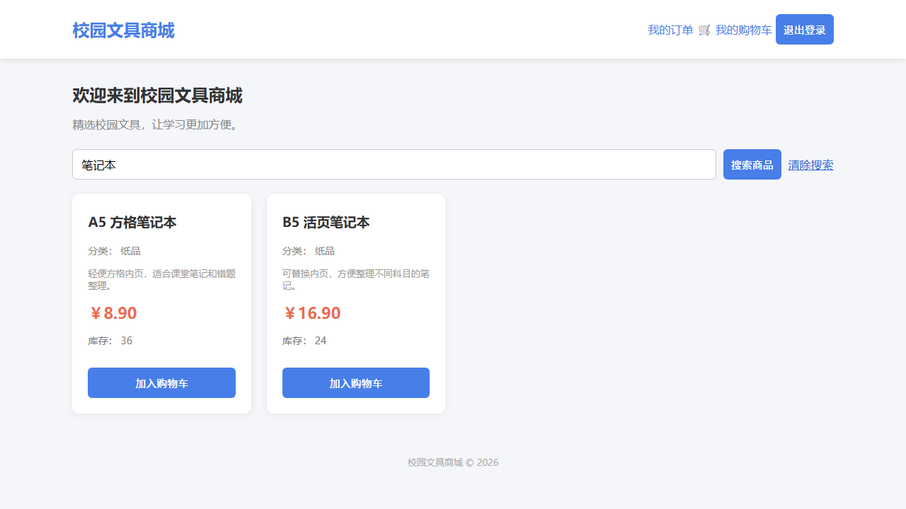
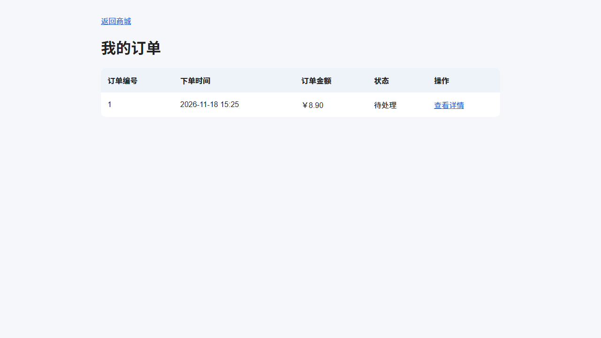
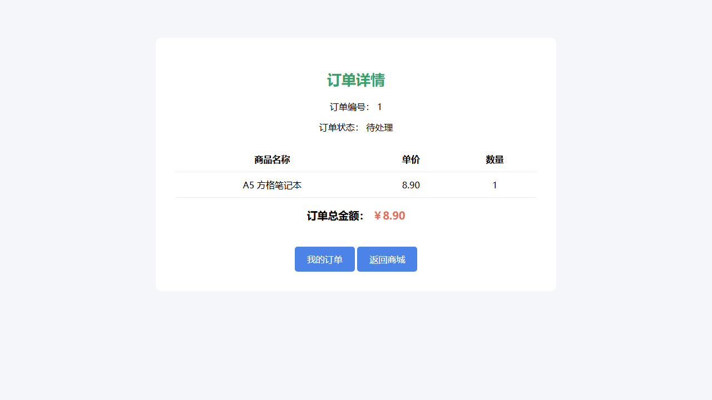

# 校园文具商城

面向校园文具选购的 Web 应用。买家可以搜索商品、加入购物车、提交订单，并在重新登录后查看自己的订单。管理员可以维护商品和库存，查看订单并处理订单状态。

## 功能

| 买家端 | 管理端 |
| --- | --- |
| 注册、登录与退出 | 管理员后台访问校验 |
| 按名称搜索上架商品 | 商品维护、上下架与库存管理 |
| 修改购物车数量并结算 | 查看订单、完成或取消订单 |
| 查看本人订单的状态与明细 | 取消订单后回补库存 |

## 技术栈

Java 25 · Spring Boot 4.1.2 · Spring MVC · Thymeleaf · Spring Data JPA · Spring Security · MySQL · Maven Wrapper

## 本地运行

1. 安装 JDK 25 和 MySQL 8，启动 MySQL。项目默认连接 `localhost:3306`。
2. 用有建库权限的 MySQL 账号在 Workbench 打开并执行 [`database/init.sql`](database/init.sql)，创建 `stationery_shop`。应用账号需要该库的读写、建表和修改表结构权限。可使用已有账号，并在下一步替换用户名。

3. 在项目根目录运行以下 PowerShell 命令。将用户名替换为你的本地 MySQL 账号。首次启动时，Hibernate 会创建或更新表结构。

   ```powershell
   $env:SPRING_DATASOURCE_USERNAME = 'stationery_app'
   $env:DB_PASSWORD = Read-Host '请输入 MySQL 密码' -MaskInput
   .\mvnw.cmd spring-boot:run
   ```

4. 首次启动完成后，在 Workbench 选中 `stationery_shop`，执行 [`database/demo-data.sql`](database/demo-data.sql) 导入五件虚构商品。同名商品会跳过，已有价格和库存不会被覆盖。
5. 打开 [商城首页](http://localhost:8080/shop)，在 [注册页](http://localhost:8080/register) 创建买家账号并登录。如需演示管理端，另外注册一个本地账号（例如 `demo-admin`），在 Workbench 执行以下语句，然后用该账号重新登录。

   ```sql
   UPDATE stationery_shop.user_account
   SET role = 'ADMIN'
   WHERE username = 'demo-admin';
   ```

## 项目截图

以下截图来自本地演示环境，使用脚本中的样例商品和一笔演示订单。

### 商品搜索



### 我的订单



### 订单详情



## 安全与库存

- 商品删除和退出登录使用 POST。Spring Security 校验写操作的 CSRF 令牌，管理端由会话权限拦截。

- 下单时通过带库存和上架条件的数据库更新扣减库存。扣减、保存订单和清空购物车在同一事务内执行。
- 订单明细保存下单时的商品名称、单价和数量。订单列表与详情按登录账号查询，其他账号的订单详情返回 404。
- 管理员处理订单时使用数据库行锁，取消订单的状态变更与库存回补在同一事务内执行。

## 验证

运行 `.\mvnw.cmd test` 执行自动化回归测试。测试使用内存 H2，无需 MySQL 凭据，覆盖管理员删除权限与 CSRF、买家下单及订单归属、并发扣减、库存回滚和并发取消。

### MySQL 8.0 实际验收

在与原有数据库隔离的 MySQL 8.0.46 实例上完成验收。实例使用独立数据目录和 `127.0.0.1:13316`，Spring Boot 使用 `18081` 端口。项目仍通过 MySQL Connector/J 和现有 JPA 配置运行。

复现时，先启动你自己的独立 MySQL 实例，再在该实例上执行建库脚本。以下命令只为当前 PowerShell 会话指定数据库地址和账号，请按实际隔离实例调整：

```powershell
$env:SPRING_DATASOURCE_URL = 'jdbc:mysql://127.0.0.1:13316/stationery_shop?useSSL=false&allowPublicKeyRetrieval=true&serverTimezone=Asia/Tokyo&characterEncoding=UTF-8'
$env:SPRING_DATASOURCE_USERNAME = 'stationery_app'
$env:DB_PASSWORD = Read-Host '请输入隔离实例的 MySQL 密码' -MaskInput
$env:SERVER_PORT = '18081'
.\mvnw.cmd spring-boot:run
```

等 Spring Boot 启动并由 Hibernate 建表后，在隔离实例的 `stationery_shop` 中导入 [演示商品](database/demo-data.sql)。注册买家和管理员演示账号，按「本地运行」的步骤授权管理员。

| 验收项 | 实测结果 |
| --- | --- |
| 建库和导入 | `init.sql` 创建 UTF-8（`utf8mb4`）数据库，首次导入 5 件上架商品，重复导入仍为 5 件。 |
| JPA 映射 | 5 张表、32 个字段与实体一致，核对了主键、自增、字段类型及可空性、用户名唯一约束和 2 个外键。 |
| 登录与商品查询 | 买家和管理员登录后进入各自页面，错误密码被拒绝。搜索「笔记本」只返回两件匹配商品。 |
| 购物车和下单 | 加购后改为 2 件，下单前库存为 36；结算金额为 17.80 元，订单和明细已保存，购物车清空，库存降至 34。 |
| 订单权限 | 买家能打开自己的订单，其他买家访问该订单返回 HTTP 404。 |
| 取消与回补 | 管理员取消后订单状态变为「已取消」，库存恢复至 36；再次取消仍为 36。缺少 CSRF 令牌的取消请求返回 HTTP 403。 |

上述流程通过 HTTP 请求和 MySQL 查询核对。并发抢购、失败回滚和并发取消的自动化回归使用内存 H2。
